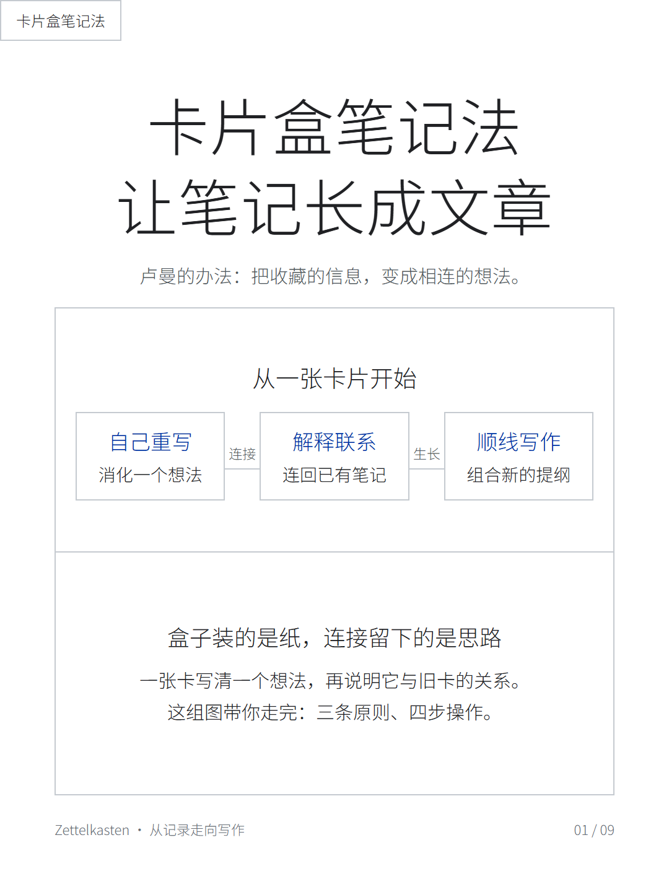
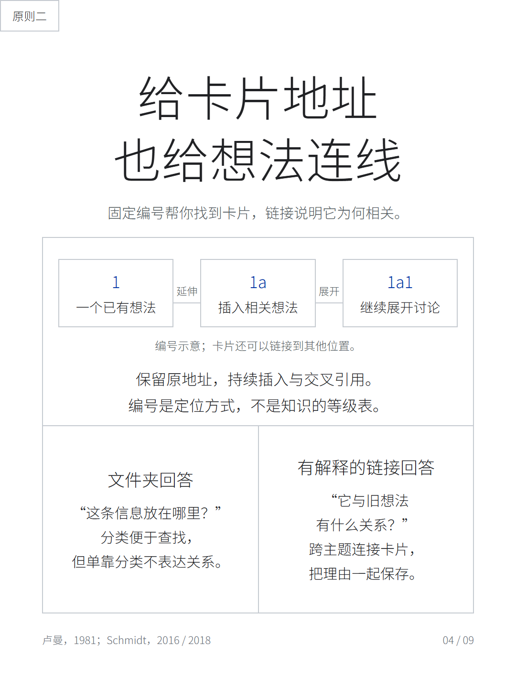
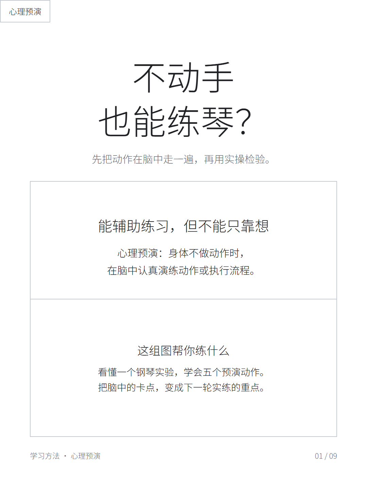
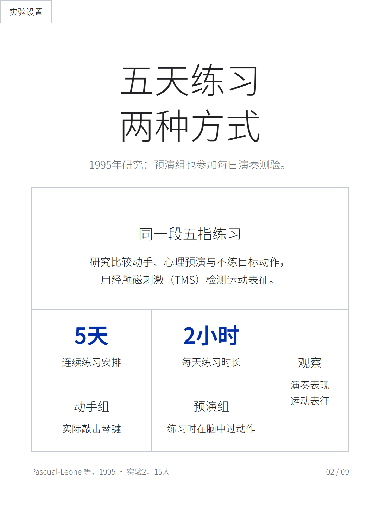
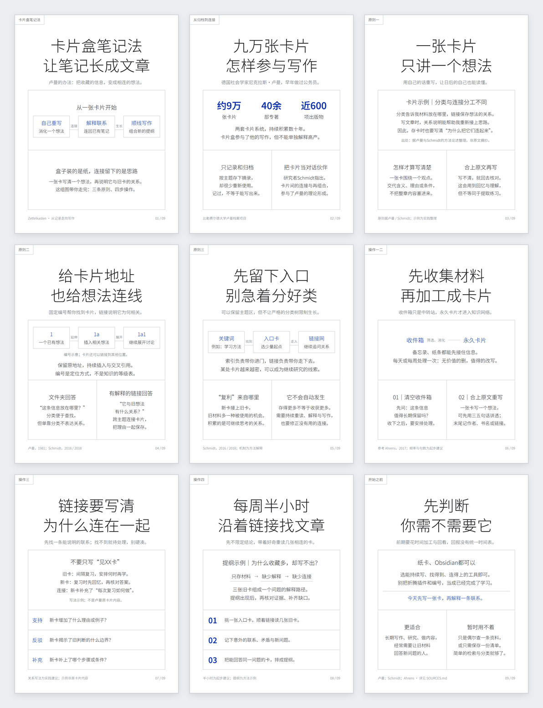
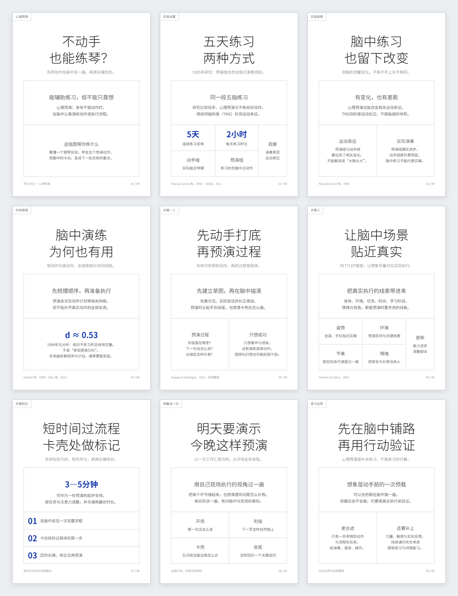

# 图文卡片

**把文章、笔记和方法教程，排成可以直接发布的多页知识卡片。**

一个面向 Codex 的开源 Skill。默认采用白底细线网格风：居中大标题、细无衬线字体、浅灰分格和充分留白，用少量蓝色突出关键数据。每页 1080 × 1440，3:4 比例。

当前版本 **v1.3.3** · 调用名 `$text-image-notes` · [下载安装包](https://github.com/Gerson369/text-image-notes/releases/latest) · [MIT 许可](LICENSE)

## 单页案例

下面展示的都是已经生成、可以直接发布的独立 PNG。单页每行 3 张，点击图片查看原图；每套完整 9 张也保留在对应目录中。

### 卡片盒笔记法

把人物案例、笔记原则与具体操作拆成连续卡片。用细线关系图讲清卡片如何连接，用短句说明每一步怎么做。

<table>
<tr>
<td width="33%" align="center"><a href="docs/examples/zettelkasten/png/01_封面.png"></a><br>封面：让笔记长成文章</td>
<td width="33%" align="center"><a href="docs/examples/zettelkasten/png/04_固定地址.png"></a><br>内容页：给卡片地址，也给想法连线</td>
<td width="33%" align="center"><a href="docs/examples/zettelkasten/png/07_解释链接.png"></a><br>操作页：把链接的理由写清楚</td>
</tr>
</table>

[查看完整 9 张单页](docs/examples/zettelkasten/png) · [研究出处与编辑说明](docs/examples/zettelkasten/SOURCES.md)

### 心理预演

从钢琴实验讲到实际使用方法，把实验发现、适用边界和行动步骤分别说清楚。数字只在需要时突出，不铺整格大色块。

<table>
<tr>
<td width="33%" align="center"><a href="docs/examples/mental-practice/png/01_封面.png"></a><br>封面：不动手，也能练琴？</td>
<td width="33%" align="center"><a href="docs/examples/mental-practice/png/02_钢琴实验.png"></a><br>证据页：五天练习，两种方式</td>
<td width="33%" align="center"><a href="docs/examples/mental-practice/png/07_短练查卡点.png"></a><br>步骤页：短时间过流程，卡壳处做标记</td>
</tr>
</table>

[查看完整 9 张单页](docs/examples/mental-practice/png) · [研究出处与编辑说明](docs/examples/mental-practice/SOURCES.md)

## 整套总览

拼图每行 2 张。总览保留每张卡片的完整比例，卡片之间有间距、细边框和轻阴影。

<table>
<tr>
<td width="50%" align="center"><a href="docs/examples/zettelkasten/overview.png"></a><br>卡片盒笔记法 · 9 张</td>
<td width="50%" align="center"><a href="docs/examples/mental-practice/overview.png"></a><br>心理预演 · 9 张</td>
</tr>
</table>

## 能做什么

- 将长文重组为封面＋完整内容页，保留关键依据和限制条件。
- 根据内容选择双栏、四格、步骤或右侧通栏，不机械复制相同布局。
- 标题居中、最多两行；整页左上角保留贴边矩形栏目签。
- 使用白底、细字体、浅灰边线与局部数据强调。
- 交付独立 PNG、可编辑 HTML、本地字体、来源说明和发布文案。
- 检查文字越界、字号、字体加载、模块结构与栏目签位置，再生成完整总览。

适合知识分享、文章拆页、读书笔记、方法教程、学习卡片与小红书图文。可按需要使用照片；当前技能在只有文字时，会询问一次配图来源或是否使用纯文字版。

## 安装与使用

### 安装到 Codex

从 [Releases](https://github.com/Gerson369/text-image-notes/releases/latest) 下载 `text-image-notes-v1.3.3.zip`，解压后将整个 `text-image-notes` 文件夹放入 Codex 的技能目录 `~/.codex/skills/`。安装后显示为 **图文卡片 · v1.3.3**。

也可以通过 Git 安装：

```bash
git clone https://github.com/Gerson369/text-image-notes.git ~/.codex/skills/text-image-notes
```

已存在同名文件夹时，请先备份，避免覆盖自己的改动。

### 调用示例

```text
$text-image-notes

把下面的文章做成一套完整的 3:4 图文卡片，包含封面和内容页。
使用白底细线网格风、纯文字与细线关系图。
PNG 图片和 HTML 源文件分开放，并附整套总览。

【在这里粘贴文章】
```

Skill 负责指导支持技能的 AI 助手理解内容、分页、排版与调用脚本；仅下载本仓库不会自动生成图片。无需图片生成 API 即可使用文字与细线模块完成出图。

## 本地渲染

需要 Python 3.10+、Node.js 18+、Pillow、Playwright 与 Chromium。以下命令在仓库根目录执行：

```bash
python -m pip install Pillow
npm install --no-save playwright
npx playwright install chromium

node scripts/check_card.mjs examples/02_双栏对比.html --png card.png
python scripts/compose_sheet.py docs/examples/mental-practice/png --out overview.png
python scripts/quick_validate.py
```

已有 Playwright 或浏览器时，可通过 `PLAYWRIGHT_MODULE` 指定模块绝对入口，通过 `CHROMIUM_PATH` 指定浏览器。HTML 通过相对路径加载 `assets/NotoSansSC-VF.ttf`，复制页面时请一起保留字体与授权文件。

## 交付目录示例

```text
文章标题/
├── PNG图片/          # 每张单页 PNG，同编号对应 HTML
├── HTML源文件/       # 可编辑页面，使用 ../assets/ 相对路径
├── assets/           # 本地字体、许可及需要的图片
├── 总览.png
├── SOURCES.md
└── 发布文案.txt
```

## 项目结构

| 目录或文件 | 用途 |
| --- | --- |
| `SKILL.md` | 技能入口与制作规范 |
| `agents/openai.yaml` | 中文显示名、版本和默认调用提示 |
| `references/` | 内容、布局、字体、照片与检查规则 |
| `templates/` | 可复用 HTML 模板与提示模板 |
| `scripts/` | 页面检查、PNG 渲染、总览与可选视频交接 |
| `examples/` | 五种可编辑布局样张 |
| `docs/examples/` | 两套真实案例，共 18 张单页及 2 张总览 |
| `assets/` | 本地字体与 OFL 许可 |

需要视频交接时再使用 `scripts/export_for_video.py`，详见 [交接说明](references/video-handoff.md)。静态图片渲染与外部视频播放器属于不同流程；外部视频效果需另行验证。

## 许可

项目代码与自制排版示例采用 [MIT License](LICENSE)。字体采用 [SIL OFL 1.1](assets/OFL.txt)，详见 [NOTICE.md](NOTICE.md)。案例中的论文与资料保留各自来源及权利归属。
